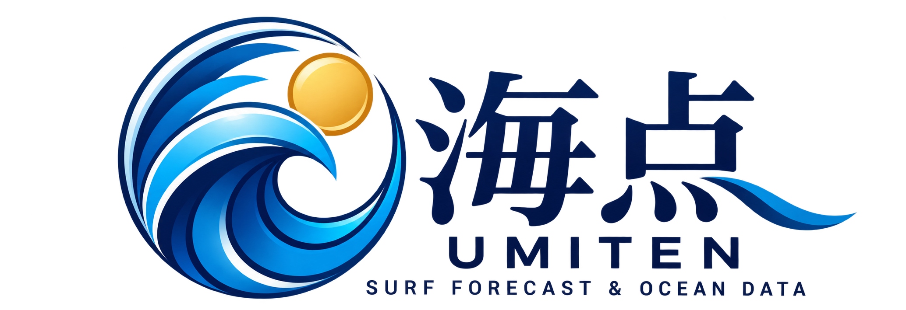

<p align="center">
  <a href="https://umiten-lab.github.io/umiten-site/">
    <picture>
      <source media="(prefers-color-scheme: dark)" srcset="docs/assets/umiten-logo-dark.png">
      
    </picture>
  </a>
</p>

<h1 align="center">海点 | UMITEN</h1>
<p align="center"><strong>SURF FORECAST & OCEAN DATA</strong><br><em>海を読む。もっと自由に。</em></p>
<p align="center">
  <a href="https://umiten-lab.github.io/umiten-site/"><strong>海点の波予報を見る</strong></a>
  · <a href="https://github.com/umiten-lab/umiten-site">GitHub Repository</a>
</p>

---

## 海点とは

**海点（UMITEN）** は、気象・海洋の数値予報とポイントごとの海岸条件を組み合わせ、サーフィンのための波の状態を推定するプロジェクトです。

沖の波高だけでは、岸でどのような波が割れるかは決まりません。波向・周期・風・地形などを踏まえて、**「どこで、いつ、どんな波が期待できるか」** を分かりやすく伝えることを目指しています。

> **DATA × OCEAN × SURFING**  
> 海を読む。もっと自由に。

## 対応サーフポイント

現在は茨城県沿岸の次の5ポイントに対応しています。表示順は北から南です。

1. **大貫つるかめ**
2. **大貫海の子**
3. **大竹海岸**
4. **濁沢**
5. **とっぷさんて**

各ポイントの緯度・経度、海岸の代表方位、水深・波高補正係数は [`points.json`](points.json) に定義しています。**座標・海岸方位・補正係数の一部は公開資料から求めた暫定設定**で、砂州の形状や堤防による遮蔽などは十分に反映していません。

## 主な機能

| 機能 | 内容 |
| --- | --- |
| ポイント別予報 | 5地点の岸の推定波高、沖の波高、周期、波向、風、気温、海水温などを確認 |
| ショート／ロング切り替え | ボード別の波サイズ適性・風向適性を考慮した独自の総合評価 |
| 5段階スコア | **◎ 85〜100 / ○ 70〜84 / △ 55〜69 / ▼ 40〜54 / × 0〜39点** |
| おすすめ時間帯 | 現在以降、日中の**55点以上**の時間帯から最高点を選定。候補がなくても評価は表示 |
| 面の整い具合 | 直前の風履歴を考慮した時間応答モデルによって海面の状態を推定 |
| 週間・時系列予報 | 最長約7日分の見通し、時間変化、波高・風・潮位の推移、詳細テーブル。時系列の端からのスワイプやMOREで翌日へ移動 |
| 潮回り・月齢 | **大潮・中潮・小潮・長潮・若潮**、日本時間正午の月齢・月相を潮位グラフに併記 |
| ウェット指数 | **気温・海水温・風速**から、保温が必要な程度と参考ウェットスーツを提案 |
| データの出典 | API応答から得た気象・海洋モデルの**参照格子点座標**などを表示 |
| 画面テーマ | **サンライズ / デイライト / サンセット / ナイト / ミッドナイト** の5種類。選択をブラウザに保存 |
| 表示言語 | **日本語 / English** の切り替え。ポイント・日付・テーマ・ボード選択を保持 |
| スマートフォン表示 | 横スクロールする時系列表の見出し・目盛りを固定するなど、小画面に対応 |

### 総合スコアの考え方

総合スコア（0〜100点）は、**岸の推定波高、面の整い具合、周期、風向・風速**を使う経験的な指標です。ショートボードとロングボードは、好ましい波サイズ・風向のパラメータを分けています。

**採点について（暫定・経験的モデル）**：ショートはコシ〜アタマを適性範囲とし、ハラ〜カタを中心に高めに評価します。ロングの理想波高の設定は従来どおりですが、両ボードとも面のクリーン度を非線形に評価し、風・周期・サイズが揃わない限り○以上になりにくくしています。◎○△▼×の境界値は維持します。

**夜間について**：日没後も波の総合評価を×に変更せず、予測された波質の点数を表示します。ただし暗い時間帯は「おすすめ」から除外し、現在のコメントで入水を勧めない旨を案内します。

「おすすめ」は予報スコアと連動しており、△（55〜69点）も候補に含めます。▼（40〜54点）は「多少できるかもしれない」状態として評価を残しますが、積極的なおすすめ枠には含めません。日没前に入水できる時間帯を対象に選び、日没後の高得点をおすすめすることはありません。

### 面の状態を推定する時間応答モデル v2

風がオフショアに変わった直後に面が突然最高の状態になるとは限らず、また強いオンショアが吹き始めても実際の海面には時間的な変化があります。

そこで海点では、**直近1日分のモデル予報による風履歴**を含む時系列を用い、各時間帯の「面が向かう状態」と現在の「推定面状態」を分けて計算します。

\[
Q_{t+\Delta t}=Q_{\mathrm{eq}}+(Q_t-Q_{\mathrm{eq}})\exp(-\Delta t/\tau)
\]

- `Q`：面の整い具合（0〜1。1に近いほど整っている）。
- `Q_eq`：その風・波の条件が続いた場合に向かう面の状態。
- `τ`：面が荒れる／整う速さを決める時定数。オンショア・オフショアの強さ、風波の割合、うねり周期などから補正。

荒れるときと回復するときで異なる基準時定数を持たせ、**強いオンショアでは荒れやすく、風が収まった後は徐々に整う**ようにしています。無風でもゼロ除算や不自然な即時変化を起こさない構成です。

このモデルは**経験則による暫定推定であり、海面状態を直接観測したものではありません**。風の履歴は実際の現地観測ではなく、Open-Meteoから取得した過去期間のモデル予報値です。係数は今後、現地記録や観測と照合して調整する必要があります。

### 岸の波高の推定

沖の波浪を、うねり・二次うねり・風波などに分け、**線形波理論による浅水変形と屈折**を簡易的に計算して岸の波高に換算します。等深線が岸と平行であるなどの仮定があり、砕波・複雑な地形・人工構造物の影響は完全には再現できません。

### ウェット指数

指数は**0が軽装寄り、100が高い保温性を要する目安**です。その日の入水可能な日中の予報から、気温と海水温の低めの値（20パーセンタイル）、風速の強めの値（80パーセンタイル）を用います。装備区分のしきい値は、気温・水温の参考範囲の暖かい側80%付近を目安にしています。

**気温・水温・風から求める独自の参考値**であり、実測の体感温度や防寒性能を保証するものではありません。日射、運動量、体質、入水時間、ウェットの厚み・状態などでも適切な装備は変わります。

## データの出典と更新

- [Open-Meteo Marine API](https://open-meteo.com/en/docs/marine-weather-api) — 波高・周期・波向、うねり・風波、海水温、海面高度など。
- [Open-Meteo Weather API](https://open-meteo.com/en/docs) — 風向・風速・突風（取得できる場合）、気温、天気コードなど。風は利用可能な場合に**JMA Seamless** を優先し、不足する場合は別モデルに切り替えます。
- [気象庁](https://www.jma.go.jp/) / [NOWPHAS](https://www.mlit.go.jp/kowan/nowphas/) — 気象・波浪の参考情報。現行のスコアへの常時自動同化を意味するものではありません。

予報の海面高度は**平均海面を基準としたモデル値**です。港の検潮所の実測潮位そのものではありません。**潮名は新月を基準にした日本の旧暦日付からの暦上の目安**（地方・潮見表で若干の差があります）で、モデル潮位の干満差から判定したものではありません。**月齢は日本時間の正午**の新月からの経過日数を天文学的な近似計算で表示します。また、APIの参照格子点は実際のサーフポイント座標と一致するとは限りません。

サイトは **GitHub Pages** で公開し、**GitHub Actions** による定期実行（設定上は約3時間ごと）で Python が予報JSONを更新します。実行間隔やデータ更新は配信側・GitHub側の状況に左右されます。

```text
Open-Meteo Weather API / Marine API
                ↓
      Python: scripts/forecast.py
      ・各ポイントの岸波高推定
      ・風履歴に基づく面の時間応答
      ・ショート／ロング別スコア
                ↓
       docs/data/forecast.json
                ↓
     docs/index.html（GitHub Pages）
                ↓
          PC / スマートフォン
```

## プロジェクト構成

| ファイル・ディレクトリ | 役割 |
| --- | --- |
| `docs/index.html` | サイト画面、5テーマ、時間別表示、おすすめ枠、ウェット指数 |
| `docs/assets/umiten-logo-light.png` | GitHub README表示用ロゴ（明るい背景向け） |
| `docs/assets/umiten-logo-dark.png` | GitHub README表示用ロゴ（暗い背景向け） |
| `docs/data/forecast.json` | 予報生成時に出力するJSON（自動生成物） |
| `scripts/forecast.py` | API取得、岸波高、面の状態、総合スコア、予報JSONの生成 |
| `points.json` | 5ポイントの座標・海岸方位・補正パラメータ |
| `.github/workflows/update.yml` | GitHub Actionsの自動実行とサイト公開の設定 |
| `test_surface.py` | 面の時間応答モデルのオフライン試験コード（任意） |

**Technology:** HTML / CSS / JavaScript / Python（標準ライブラリ） / GitHub Actions / GitHub Pages

## 開発・検証の方針

海点は**開発・検証中の独自モデル**です。今後は、ポイントごとの位置・海岸方位・補正値の精査、波浪観測値や現地記録との比較、面の回復・悪化時定数の校正、予報誤差や信頼度の評価を進めます。

## ご利用にあたって

> **海点の表示値は参考予報であり、安全性を保証するものではありません。** 予測と現地の波にはずれが生じます。離岸流、急な気象変化、障害物、海底地形、遊泳・入水規制なども確認し、現地の安全情報と自身の技量を優先してください。

---

<p align="center"><strong>UMITEN LAB</strong><br>
SURF FORECAST & OCEAN DATA<br>
海を読む。もっと自由に。</p>


### 表示言語 / Language

画面右上の **日本語 / English** で表示言語を切り替えられます。選択はブラウザに保存され、5テーマ・地点・日付・ボード選択に影響しません。予報データ・スコアは共通です。

### 潮回り表示の参考資料

- [MIRC（日本水路協会 海洋情報研究センター）潮名の解説](https://www.mirc.jha.or.jp/online/w/w-tide/knowledge/desc.html)
- [気象庁 潮汐・海面水位の用語集](https://www.data.jma.go.jp/kaiyou/db/tide/knowledge/tide/yougo.html)

潮名は旧暦日からの伝統的な分類、月齢は新月時刻に基づく計算値で、潮位そのものの予測とは別情報です。
