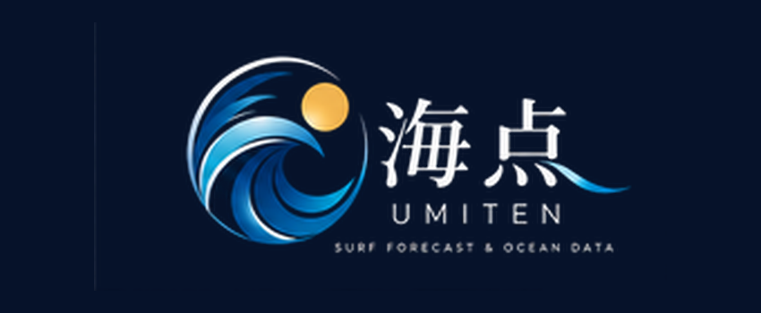

<p align="center">
  <a href="https://umiten-lab.github.io/umiten-site/">
    
  </a>
</p>

<h1 align="center">海点 | UMITEN</h1>
<p align="center"><strong>SURF FORECAST & OCEAN DATA</strong></p>
<p align="center"><em>海を読む。もっと自由に。</em></p>

<p align="center">
  <a href="https://umiten-lab.github.io/umiten-site/"><strong>波予想サイトを開く</strong></a>
  ·
  <a href="https://github.com/umiten-lab/umiten-site">GitHub Repository</a>
</p>

---

## 海点とは

**海点（UMITEN）** は、気象・海洋データと数値計算を組み合わせて、サーフポイントごとの波のコンディションを読み解く波予測プロジェクトです。

「沖の波が高い」ことと「そのポイントで良い波が割れる」ことは、必ずしも同じではありません。うねりの向きや周期、風向・風速、潮位、海岸の向きなどが重なり、実際の波のサイズや質は変化します。

海点が目指すのは、**沖の予報をそのまま並べるだけでなく、サーファーが知りたい「いつ・どこで・どんな波になりそうか」に近づくこと。** 数値モデルの結果と現場の経験を結びつけ、予測を継続的に検証・改善していきます。

> **DATA × OCEAN × SURFING**  
> 感覚を大切にしながら、判断をデータでも支える。

## 海点が大切にする3つのこと

### 01 — Point Specific｜ポイントごとに考える

同じうねりでも、海岸線の向きや周辺地形によって波の入り方は異なります。海点ではポイント単位で条件を設定し、沖合の波浪データから岸に近い波を推定する仕組みを採用しています。

### 02 — Data Driven｜数字で確かめる

波高だけでなく、波の周期・向き、風、潮位、水温、気温などの情報を組み合わせて確認します。予測の根拠を見える形にし、将来的には予測値と実際の波の差を定量的に評価します。

### 03 — Continuous Improvement｜予測を育てる

最初から完璧な予報をうたうのではなく、検証と改善を重ねて精度を高める方針です。過去の予報、観測データ、現地でのサーフィン記録を活用したモデル改善を目指しています。

## 現在利用できる機能

- **ポイント別の波予想** — 登録地点ごとにコンディションを表示。
- **波浪データ** — 沖合の波高・周期・方向、風波、主要うねり、第二うねりを確認。
- **岸の波高の推定** — 波の入射方向、簡易的な浅水変形・屈折を用いた波高推定。
- **風のコンディション** — 風向と海岸の向きから、オンショア・オフショアなどを分類。
- **コンディションスコア** — 波のサイズ、面の状態、周期を組み合わせた参考評価。
- **潮位・水温・気温** — 海面高度、海面水温、気象条件を確認。
- **時間帯別の詳細** — 波の推移、潮位グラフ、2時間ごとの詳細テーブル。
- **外部データへのリンク** — 天気図、台風、アメダス、NOWPHAS、潮位表など。
現在の予報取得設定は**最大7日先**を対象としています。データの提供状況により、表示可能な期間・項目は変わる場合があります。

## 対応サーフポイント

現在は茨城県沿岸の次の3ポイントからスタートしています。

- **大貫つるかめ** — 大洗エリア
- **大竹海岸** — 鹿行エリア
- **とっぷさんて** — 鹿行エリア

一部ポイントの座標・海岸の向き・補正係数は暫定値です。今後、現地情報や観測との比較に基づいて見直していきます。ポイントの追加も順次検討します。

## 波の予測はどう作られるか

海点の現行モデルは、外部の予報データにポイントごとの簡易補正を加える方式です。

```text
気象・海洋予報データ
      ↓
ポイント別の補正
      ↓
岸の波高と海面状態を推定
      ↓
時間帯別の波予報・スコア
```

### 波高の推定

線形波理論に基づく**屈折・浅水変形**を簡易的に計算し、沖合の波の成分から岸に近い波高を推定します。現段階では海底の等深線が海岸と平行であることなどを仮定しており、複雑な海底地形、堤防の遮蔽、砕波過程などを十分に表現したものではありません。

### 風と海面状態

海岸の向きに対する風向を分類し、風速も使って海面状態を評価します。また、風向が切り替わっても水面が瞬時には変化しないことを考え、**風の変化に対する時間差**を簡易的に取り入れています。

### コンディションスコア

現在の参考スコアは、**岸の推定波高・海面状態・波の周期**を組み合わせた独自の暫定的な計算です。実際のサーフィンの満足度や安全性を保証する評価値ではありません。評価式と係数は、今後の検証対象です。

## データと更新の仕組み

予報データの取得には主に [Open-Meteo](https://open-meteo.com/) の海洋・気象APIを利用しています。風は取得可能な場合に気象庁系モデルを優先する構成です。

このサイトは **GitHub Pages** 上で公開され、**GitHub Actions** を利用して原則3時間ごとに予報データを更新する設計です。定期実行はGitHub側の状況により遅延・停止する場合があります。

```text
Open-Meteo API
      ↓
Pythonによる予報データ取得・簡易計算
      ↓
forecast.json を生成
      ↓
GitHub Pages にWebサイトを公開
      ↓
スマートフォン・PCのブラウザから閲覧
```

## 今後の開発ロードマップ

**現在の実装機能と、以下の構想・開発予定は区別しています。** 優先順位や内容は検証結果によって変更することがあります。

- [ ] 対応ポイントの拡充と位置・地形パラメータの精査
- [ ] 過去の予報値・予報発表時刻の蓄積
- [ ] NOWPHASなどの実測データを用いたモデル評価
- [ ] ポイントごとの予報誤差の分析と補正
- [ ] 風向・うねり・潮位の組み合わせに基づくスコア改善
- [ ] サーフィン記録と体感コンディションの入力
- [ ] 地形・遮蔽・浅海変形をより適切に扱うモデルの検討
- [ ] 予報の信頼度や不確実性の表示
- [ ] iPhone向けの使いやすさとホーム画面利用の改善

### 予測精度の考え方

単に「当たった」「外れた」という印象だけでなく、**実際に利用可能だった予報値**を保存し、観測値や現地記録と比較していくことが重要だと考えています。将来的には波高の誤差指標、予測リードタイム別の性能、コンディション分類の一致率などを評価し、モデルの改良に反映させる方針です。

## プロジェクト構成

- `docs/index.html` — Webサイトの画面・表示処理。
- `docs/assets/umiten-readme-logo.png` — Webサイトのロゴと統一した、GitHub表示用の画像。
- `docs/data/forecast.json` — 自動処理によって生成・公開される予報データ。
- `scripts/forecast.py` — データ取得、岸の波高・面の状態の簡易推定、JSON生成。
- `points.json` — サーフポイントごとの位置・補正パラメータ。
- `.github/workflows/update.yml` — GitHub Actionsによる予報生成と公開の自動化。
**技術構成：** HTML / CSS / JavaScript / Python / GitHub Actions / GitHub Pages

## データ提供元・参考情報

- [Open-Meteo](https://open-meteo.com/) — 気象・海洋予報データ
- [気象庁](https://www.jma.go.jp/) — 天気図・気象情報・潮位関連情報
- [NOWPHAS（全国港湾海洋波浪情報網）](https://www.mlit.go.jp/kowan/nowphas/) — 波浪観測に関する情報

データの著作権・利用条件はそれぞれの提供元に帰属します。特にOpen-Meteoの無料APIには利用区分や表示義務などの条件があるため、商用利用や二次配信の際は最新の規約を確認します。

## ご利用にあたって

> **海点の波予報は開発・検証段階です。** 予測結果には誤差があり、局所的な波の急変、離岸流、海底地形、障害物、天候の急変などを網羅していません。サーフィンの可否や安全判断は、現地の最新情報・警報・海況・自分自身の技量などを踏まえて行ってください。

## UMITEN LAB

**海点（UMITEN）** は、海を楽しむ人のための、データに基づくサーフフォーキャストを目指すプロジェクトです。

波を知ることは、海をもっと楽しむこと。  
海を読む。もっと自由に。

**UMITEN LAB — Surf Forecast & Ocean Data**

[**Visit UMITEN →**](https://umiten-lab.github.io/umiten-site/)

