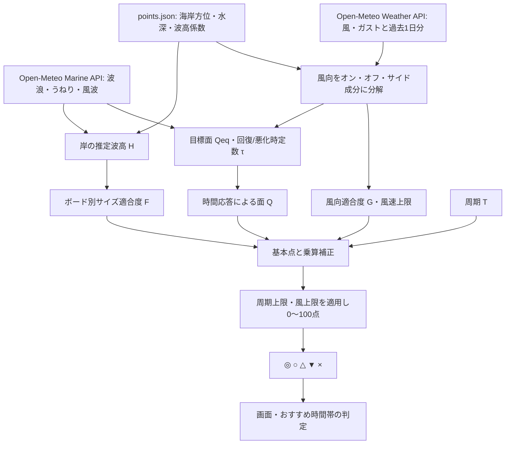

# 海点 UMITEN — 波コンディション採点アルゴリズム

> **実装準拠版：2026年11月2日**  
> 対象コード：`scripts/forecast.py`（小波の適性・風履歴を重視する最新版）／設定：`points.json`  
> 目的：計算の根拠、各係数、評価記号への変換、例外処理、今後の校正方針を再現可能な形で記録する。

**海点の評価は実測・安全性の保証ではない。** 気象・波浪の数値予報値を入力とする経験的なスコア（0〜100点）であり、現地のサーフ可能性を統計的に校正した確率ではない。特に `Q`（面の整い具合）、地点別の岸波高係数、風向上限などは試験的設定である。

## 目次

1. [全体像と評価記号](#1-全体像と評価記号)
2. [入力データと岸波高](#2-入力データと岸波高)
3. [風の履歴を使う面の時間応答モデル](#3-風の履歴を使う面の時間応答モデル)
4. [ショートとロングのサイズ適合度](#4-ショートとロングのサイズ適合度)
5. [風向の適合度と風速別の上限](#5-風向の適合度と風速別の上限)
6. [周期の評価と上限](#6-周期の評価と上限)
7. [総合スコアの最終式](#7-総合スコアの最終式)
8. [計算例と検証用ケース](#8-計算例と検証用ケース)
9. [地点別設定](#9-地点別設定)
10. [おすすめ時間帯と採点の関係](#10-おすすめ時間帯と採点の関係)
11. [制約・注意点・校正方針](#11-制約注意点校正方針)

---

## 1. 全体像と評価記号

※ `K` ではさらに日中の可用時間を判定するが、**暗さを理由に `I` の点数は下げない**。

| 表示 | 点数 | 解釈 | おすすめ候補になるか |
|:--:|--:|---|:--:|
| ◎ | 85〜100 | 最高 | なる（日中） |
| ○ | 70〜84 | 良好 | なる（日中） |
| △ | 55〜69 | まずまず | **なる（日中）** |
| ▼ | 40〜54 | 今ひとつ | 積極的には勧めない |
| × | 0〜39 | 厳しい | ならない |
| — | 欠測 | 計算できない | 判定不可 |

**設計思想**：サイズだけで「ヒザだから×」「コシだから△」などと確定しない。ショート／ロング別の波高適性と、面の履歴、今の風向風速、周期を同時評価する。「○はかなり条件が整ったときだけ」の厳しめの基準は維持する。

## 2. 入力データと岸波高

### 2.1 データの出典

| 系統 | 使用する値 | 主な用途 |
|---|---|---|
| Open-Meteo Marine | `wave_height`, `wave_period`, `wave_direction` | 全体波高・周期・方向 |
| Marine | `swell_wave_*`, `secondary_swell_wave_*` | 主うねり・二次うねりの屈折・浅水変形 |
| Marine | `wind_wave_*` | 風波を波高推定と面補助減点に使用 |
| Weather | `wind_speed_10m`, `wind_direction_10m` | 風のオン/オフ/サイド成分・風向適合度 |
| Weather | `wind_gusts_10m`（ある場合） | 面への弱いガスト補正 |
| `points.json` | `facing`, `depth_m`, `scale` | 地点別の海岸方位、近岸の計算水深、波高の係数 |

風はまず **JMA Seamless** を試し、変数が使えない・週間のカバー率が低い場合は取得可能なモデルへフォールバックする。過去1日分のデータは**モデル値の履歴**であり、現地の風観測履歴ではない。

### 2.2 沖から岸への簡易変換

`to_shore(H,T,θ,facing,depth)` は、各波成分について近岸波高を次のように見積もる。

- 深海波長：\(L_0=gT^2/(2\pi)\)
- 水深 \(h\) での波長：\(L=L_0\tanh(2\pi h/L)\) を反復計算
- 進入角：\(\alpha_0=|\theta-\text{facing}|\) を0〜180°で折り返した値
- 屈折後の角：\(\sin\alpha=(L/L_0)\sin\alpha_0\)
- 屈折係数：\(K_r=\sqrt{\cos\alpha_0/\cos\alpha}\)
- 浅水係数：\(K_s=\sqrt{(0.5L_0)/(nL)}\)、\(n=\tfrac12[1+2kh/\sinh(2kh)]\)、\(k=2\pi/L\)

各成分の近岸推定波高は \(H_{\mathrm{shore},i}=H_iK_rK_s\)。各地点の表示用岸波高は

$$
\boxed{H=\text{scale}\,\sqrt{\sum_i H_{\mathrm{shore},i}^{2}}}
$$

で求める。成分の二乗和で全波高に不足する場合は残差成分を補う。入射角が89°以上の成分は計算上0とする。等深線が海岸に平行という簡略化があり、**実際の砕波高・波のフェイスの高さを直接予測しているわけではない**。

## 3. 風の履歴を使う面の時間応答モデル

### 3.1 風を3成分に分解

風向（吹いて**くる**方角）と海岸の向きの差を \(\delta\) とすると、風速 \(V\) [m/s] から

$$
V_{\rm on}=V\max(\cos\delta,0),\qquad
V_{\rm off}=V\max(-\cos\delta,0),\qquad
V_{\rm side}=V|\sin\delta|
$$

を計算する。オンショアとオフショアを段階的に切り替えるのでなく、連続的に評価する。

### 3.2 同じ風が続いた場合の「目標の面」\(Q_{\rm eq}\)

面の状態を \(Q\in[0,1]\) と定義し、1が最も整っている状態とする。まず風速成分から目標値を計算する。

$$
\begin{aligned}
Q_{\rm eq}=\operatorname{clip}_{[0.04,0.96]}\bigg(&0.96
-0.86[1-e^{-(V_{\rm on}/3.8)^{1.55}}]\\
&-0.50[1-e^{-(V_{\rm side}/4.5)^{1.6}}]
-P_{\rm strong}-P_{\rm gust}-P_{\rm sea}\bigg)
\end{aligned}
$$

補助項は下表のとおり。係数は現時点では**経験的な暫定値**である。

| 項目 | 計算・条件 | 最大減点（Q単位） |
|---|---|---:|
| 強風 \(P_{\rm strong}\) | \(0.12[1-e^{-(\max(0,V-7)/3)^{1.5}}]\) | 0.12 |
| ガスト \(P_{\rm gust}\) | ガストが平均風速を2m/s以上超える部分に比例し、オン/サイド成分がある場合のみ | 0.05 |
| 風波比率 \(P_{\rm sea}\) | \(0.08\,r\)、\(r=\operatorname{clip}[(H_{\rm wind}/H_{\rm total})^2,0,1]\) | 0.08 |

### 3.3 荒れる速さと整う速さを分ける

現在の値 \(Q_{t}\) から目標 \(Q_{\rm eq}\) に向かう時定数 \(\tau\) [時間] は、改善か悪化かによって異なる。

**荒れる場合**（\(Q_{\rm eq}<Q_t\)）

$$
\tau_{\rm down}=\operatorname{clip}_{[0.60,1.8]}\left(
\frac{1.8}{1+0.22V_{\rm on}+0.10V_{\rm side}}
\right)
$$

**整う場合**（\(Q_{\rm eq}\ge Q_t\)）

$$
\begin{aligned}
\tau_{\rm up}=\operatorname{clip}_{[1.0,4.5]}\bigg[
&\frac{3.0}{1+0.16\min(6,V_{\rm off})}\\
&\times\big(1-0.15\operatorname{clip}_{[0,1]}((T_{\rm swell}-8)/6)\big)
\times(1+0.25r)\bigg]
\end{aligned}
$$

`clip` は指定範囲に収める操作。うねり周期が欠測ならその周期補正を行わない。\(r\) が欠測なら風波比率補正を行わない。\(T_{\rm swell}\) による短縮は最大15%である。地点ごとに `lag_up_h`, `lag_down_h` が設定されていれば、3.0/1.8時間の代わりに使用する。

実際の面 \(Q\) は、1時間ごとに

$$
\boxed{Q_{t+\Delta t}=Q_{\rm eq}+(Q_t-Q_{\rm eq})e^{-\Delta t/\tau}}
$$

と更新する。**時定数 \(\tau\) は「完全回復までの時間」ではない**。\(\Delta t=\tau\) で変化量の約63%が進むという意味である。風データが欠測なら前時刻の \(Q\) を保持する。

**図3は合成入力による説明用シミュレーションで、現地海況の再現や検証結果ではない。**

## 4. ショートとロングのサイズ適合度

サイズ適合度 \(F(H)\) は各ボードの制御点を**smoothstep**（\(s(u)=3u^2-2u^3\)）で区間補間した0〜1の連続関数。ショートは0.70〜0.90mの中間に最大+0.06の滑らかな補正が加わる。ロングではヒザ〜モモ付近まで適合度を広げている。

主要な波高での計算値：

| 岸波高 H | ショート F | ロング F | 参考 |
|---:|---:|---:|---|
| 0.30m | 0.100 | 0.300 | 小波。存在係数でも減点 |
| 0.40m | 0.190 | 0.490 | ロングの小波適性を考慮 |
| 0.50m | 0.280 | 0.660 | ロングなら状況により十分遊べる |
| 0.70m | 0.730 | 0.842 | ボード別に風・面も評価 |
| 0.80m | 0.905 | 0.938 | ショートのコシ付近補正を含む |
| 0.90m | 0.960 | 0.965 | 両方の適性が高い |
| 1.10m | 1.000 | 0.997 | 近傍で高い適性 |
| 1.50m | 1.000 | 0.620 | ショートの好適範囲 |
| 1.90m | 0.870 | 0.152 | 大波ではロングの適性が下がる |

**重要：Fが低くても即×にはしない。** 過去の「サイズ別の点数上限」は**最新版では撤廃済み**。ただし波そのものがほぼないときに、面が良いだけで高得点にならないよう、存在係数を使う。

$$
E(H)=s\!\left(\operatorname{clip}_{[0,1]}\frac{H-0.12}{0.26}\right)
$$

0.12m以下で \(E=0\)、0.38m以上で \(E=1\) となり、その間は連続的に変化する。

## 5. 風向の適合度と風速別の上限

最も良いオフショア風向を \((\text{facing}+180)^\circ\) とし、その方角からの角度差 \(\theta\in[0,180]\) を使う。

$$
G_{\rm wind}=1-a\left(1-\left[g_{\rm min}+(1-g_{\rm min})e^{-\frac12(\theta/\sigma)^2}\right]\right),
\quad a=\operatorname{clip}_{[0,1]}\left(\frac{V-1}{2}\right)
$$

| 板種 | \(\sigma\)（角度幅） | \(g_{\rm min}\) |
|---|---:|---:|
| ショート | 80° | 0.20 |
| ロング | 60° | 0.18 |

風速1m/s以下では風向減点はほぼ適用されず、3m/s以上で上式の角度効果が全面的に効く。**風向欠測かつ風速0.5m/s以下**は無風として許容する。

さらに瞬間的な悪化を見逃さないため、現在の風向区分と風速から**点数の上限**を設ける。区分は海側方位との角度差で決まる（オン：0〜30°、サイドオン：30〜60°、サイド：60〜120°、サイドオフ：120〜150°、オフ：150〜180°）。区分の境界は実装上の段階判定である。

| 風向区分 | 2m/sでの上限 | 3m/sでの上限 | 6m/sでの上限 |
|---|---:|---:|---:|
| オフショア | 100 | 100 | 100 |
| サイドオフ | 94 | 82 | 82 |
| サイド | 86 | 58 | 50 |
| サイドオン | 81 | 42 | 27 |
| オンショア | 78 | 29 | 11 |

上限は1.5m/s以下では100。1.5〜3m/sで線形に強まり、強風では区分別にさらに下がる。風は \(Q\) と \(G_{\rm wind}\) とこの上限の**複数箇所で作用する**。過剰な重複減点になっていないかは実地データで検証する課題。

## 6. 周期の評価と上限

周期は寄与点 \(P\)（最大10点）と上限 \(C_T\) の二通りで効く。

| 波の周期 | ショートの P | ロングの P | 周期上限 C_T |
|---|---:|---:|---:|
| 6秒未満 | 0 | 0 | 49点 |
| 6秒ちょうど | 3 | 3 | 69点 |
| 7秒 | 5 | 3 | 69点 |
| 8秒 | 7 | 7 | 100点 |
| 9秒 | 8.5 | 7 | 100点 |
| 10秒以上 | 10 | 10 | 100点 |

ショートは6〜8秒、8〜10秒で直線補間。ロングは6/8/10秒の閾値で段階的に変化。**8秒未満は条件が良くても○以上にならない**一方、7秒の実際に遊べる波が▼に固定されるわけではない。

## 7. 総合スコアの最終式

板種 \(b\) に対して、

$$
\boxed{\begin{aligned}
S_{\rm raw}&=(70Q^{2.2}+20F+P)\,[1-w_b(1-F)]\,(0.92)\,E(H)\,G_{\rm wind},\\
S&=\operatorname{clip}_{[0,100]}\left[\operatorname{round}\{\min(S_{\rm raw},C_T,C_{\rm wind})\}\right]
\end{aligned}}
$$

| 要素 | 数値・役割 |
|---|---|
| \(70Q^{2.2}\) | 面の配点：最大70点。面がある程度荒れると厳しく減点 |
| \(20F\) | ボードに合うサイズ：最大20点 |
| \(P\) | 周期：最大10点 |
| \(w_b\) | サイズ適合度の二次重み。ショート **0.45**、ロング **0.30** |
| 0.92 | 全体に掛ける厳しめの係数（経験値） |
| \(E(H)\) | 極小波のみの存在係数。0.38m以上は1 |
| \(G_{\rm wind}\) | 風向の連続補正（弱風では影響が弱い） |
| \(C_T\) | 周期による上限（49／69／100点） |
| \(C_{\rm wind}\) | 現在の風向区分・風速による上限 |

`forecast.py` 内の `score()` は**ショートとロングに分けて1回ずつ**実行され、出力JSONの `score_short` と `score_long` に保存される。画面内の複数箇所で再採点はしない。入力が欠測・非有限値の場合は0点にせず `null`（欠測）を出す。

## 8. 計算例と検証用ケース

下表は `score()` 関数を直接実行した値。**架空の統一条件**（岸が東向き90°、風は西270°のオフショア3m/s、周期10秒。最後の行のみオンショア）であり、現地予報の再解析ではない。面の \(Q\) を変えて比較した。

| 板種 | 岸波高 | 周期 | Q | 風 | 計算結果 |
|---|---:|---:|---:|---|---:|
| ロング | 0.50m | 10秒 | 0.65 | 西3m/s | ▼ 42点 |
| ロング | 0.50m | 10秒 | 0.80 | 西3m/s | △ 55点 |
| ロング | 0.50m | 10秒 | 0.96 | 西3m/s | ○ 72点 |
| ショート | 0.80m | 10秒 | 0.65 | 西3m/s | ▼ 49点 |
| ショート | 0.80m | 10秒 | 0.90 | 西3m/s | ○ 74点 |
| ショート | 1.20m | 10秒 | 0.90 | 西3m/s | ○ 79点 |
| ショート | 1.20m | 7秒 | 0.90 | 西3m/s | △ 69点（周期上限） |
| ショート | 1.20m | 10秒 | 0.90 | 東3m/s | × 21点 |

**ポイント：** 0.50mのロングでも良い面なら△・○になり得る一方、1.20mあってもオンショアなら×になり得る。サイズだけでは評価を決めていない。

## 9. 地点別設定

2026年11月2日の `points.json` より。方位は北0°・東90°・南180°の方式で「**海に面する向き**」を示す。確定した海岸線方位や砕波点の向きではない。

| ポイント | 海に向く方位 `facing` | 計算水深 | `scale` | 主な注意点 |
|---|---:|---:|---:|---|
| 大貫つるかめ | 135° | 4m | 0.75 | 防波堤などの影響は簡略化 |
| 大貫海の子 | 112.5° | 4m | 0.79 | つるかめよりサイズがやや出やすい現地情報を反映（暫定） |
| 大竹海岸 | 67.5° | 4m | 0.75 | 代表方位は推定 |
| 濁沢 | 67.5° | 4m | 0.75 | マップのピンとの厳密な座標照合は未完了 |
| とっぷさんて | 67.5° | 4m | 1.00 | 2026年10月末～11月初の現地情報をもとに波高を暫定補正 |

この係数は**岸波高の推定に掛かる**もので、総合スコアに直接加点される係数ではない。`scale=1.00` はサイズの正確さが検証済みという意味ではない。

## 10. おすすめ時間帯と採点の関係

- 評価の点数は**昼夜を問わず同じ計算式**。夜間だから×にはしない。
- サイトのおすすめ判定は、予報対象時点から日没までの**△以上（55点以上）**を候補にする。
- 今後最初に△以上となり、一定時間続く区間を案内する。その日の最高点まで無理に待たせない。
- ▼（40〜54点）や×の時刻は総合点をそのまま表示し、積極的なおすすめ区間には含めない。
- **潮位・気温・海水温・月齢は現行の総合点を直接変えない。** 気温・水温・風速はウェット指数などで使用される。

これらのおすすめ表示ルールは `docs/index.html` の実装であり、波の採点式は `scripts/forecast.py` にある。画面の改修によっておすすめ表示の挙動が変わっても、**同じ `score_short` / `score_long` を参照する**ことが整合性の条件となる。

## 11. 制約・注意点・校正方針

1. **実測との比較が不足**：今回のケース表・グラフは数値モデルの内部挙動を示すだけで、予報精度の検証ではない。地点ごとの現地動画・波サイズ・面の状態・波質を時刻を合わせて比較する必要がある。
2. **面への風の影響は重複**：風は \(Q\)、\(G_{\rm wind}\)、\(C_{\rm wind}\) に効く。特に風向変化が速い日は過剰減点がないかを検証する。
3. **周期上限は硬い境界**：6秒・8秒で上限と加点が急に変わる。将来的には移動平均や連続的な上限も検討できる。
4. **波高は簡易物理モデル**：`to_shore` は実際の砂州、沿岸地形、潮による割れ方、複数波の干渉などを十分表さない。
5. **サイズ区分は目安**：スネ・ヒザ・モモ・コシなどの目視サイズと、数値モデルの有義波高は必ずしも一致しない。
6. **データ時刻と欠測に注意**：風・海洋の時刻は文字列で照合し、欠測をゼロに置き換えない。過去時刻の予報値は実測ではない。
7. **推奨する校正手順**：現地記録を「地点・時刻・板種・目視サイズ・風向風速・面の状態・実際の満足度」で蓄積し、まず地点別岸波高、次に面の遅れ、最後に得点分布と閾値を調整する。個々の観測例に合わせた過剰適合を避ける。

---

**ソースコード対応表**

| 検証対象 | `scripts/forecast.py` の関数 |
|---|---|
| 近岸波高 | `wavelength()`, `to_shore()`, `forecast()` |
| 風の成分 | `wind_components()`, `wind_kind()` |
| 面の目標値・時間応答 | `surface_equilibrium()`, `surface_time_constant()`, `surface_quality()` |
| サイズ適性・極小波補正 | `size_suitability()`, `wave_presence_factor()` |
| 風向適性・風速上限 | `offshore_suitability()`, `wind_score_cap()` |
| 周期評価 | `period_score_points()` |
| 総合評価 | `score()` |
| 5地点設定 | `points.json` |

**最終更新：2026-11-02** ／ **UMITEN LAB** ／ **検証中の独自モデル**
